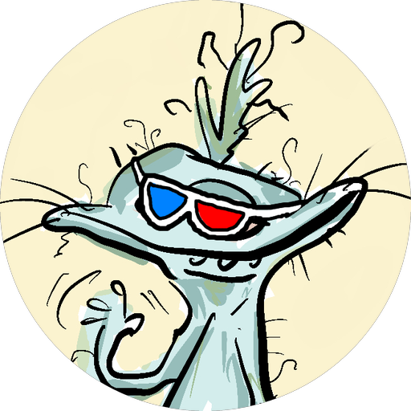
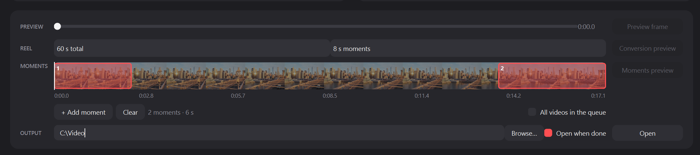

<p align="center">
  
</p>

<h1 align="center">Stereo3D Studio</h1>

<p align="center">
  <b>2D → 3D image &amp; video converter — and depth map creator — for Windows, with NVIDIA GPU acceleration.</b><br>
  Made for the Samsung Odyssey 3D, and works with 3D TVs, VR headsets and anaglyph glasses.
</p>

<p align="center">
  
</p>

Stereo3D Studio is a desktop app built on [iw3](https://github.com/nagadomi/nunif/tree/master/iw3), nagadomi's
2D-to-stereo engine. It estimates depth with modern AI depth models, builds a second eye for every frame, and encodes
the result as side-by-side (SBS) 3D video — with a queue, presets, live preview and a one-click Windows installer.

**New in 1.4.1 — faster SHARP:** several seconds saved on every frame (the splat shapes now stay on the graphics
card), and SHARP renders at 720p by default for a usable video speed.

**New in 1.4 — a standard Windows setup wizard and experimental SHARP 3D for images and video.** Install with a
normal Next → Next → Install wizard (no admin rights, uninstall from Windows Settings, your models are always kept on
updates), and try Apple's **SHARP**, which turns every picture or video frame into a real 3D scene and films it with
two virtual cameras. See [Install](#install) and [SHARP](#-sharp-3d-scene-experimental).

**New in 1.2 — a depth map creator, too.** Stereo3D Studio can now save just the depth map of any image or video, or
split images into separate files (left + right eye, or colour + depth). With the new **Lotus** and **Lotus-2** models
it makes some of the most detailed depth maps available — useful well beyond 3D video: for compositing, relighting,
displacement and 3D printing reliefs, parallax photos, or any tool that takes a depth map.

## Samples: 2D → 3D

<p align="center">
  <a href="https://youtu.be/vYIqblgsJ9o">
    
  </a>
</p>

A collection of clips converted to 3D with Stereo3D Studio.<br>
**[▶ Watch on YouTube](https://youtu.be/vYIqblgsJ9o)**<br>
**[⬇ Download the high quality version](https://1drv.ms/f/c/1f85c9e842de5eb2/IgAjcoXeWYCaSZ3xKUG53v7lAQbykXhXwq4jJwUtVYFFXB0?e=GlCYd6)** (watch in 3D on a compatible device).

## Features

- **Drag & drop queue** for videos, images and whole folders, with thumbnails; finished items leave the queue.
- **Odyssey 3D presets** — Half SBS output, Depth Anything V2 Large, MLBW + inpaint stereo, tuned for 16 GB GPUs.
- **Every 3D format**: Half / Full SBS, top-bottom, VR180, cross-eyed, anaglyph, RGB + depth — see [3D output modes](#3d-output-modes).
- **🆕 Setup wizard** — a standard Windows installer: no admin rights, Start-menu entry, uninstall from Windows
  Settings → Apps, and updates that always keep your downloaded models. See [Install](#install).
- **🧪 SHARP 3D scene (experimental) — images and video** — Apple's SHARP turns each picture or video frame into a
  real 3D scene and films it with two virtual cameras, with its own **★ Experimental · SHARP 3D scene image (Odyssey)**
  preset. See [SHARP](#-sharp-3d-scene-experimental).
- **🆕 Depth map creator** — new **Depth map only** layout and two-file image saving (left + right, or colour + depth).
  See [Depth maps & image files](#-depth-maps--image-files).
- **🆕 Lotus depth** — diffusion-based depth with very fine, crisp detail. Made for images, and works well for video
  too (just slower). Adding images switches to the **Images · Lotus (sharp detail)** preset automatically.
  See [Lotus](#-lotus-depth).
- **🧪 Lotus-2 (experimental)** — the FLUX-based successor to Lotus: the most detailed depth here, for images only.
  See [Lotus-2](#-lotus-2-experimental).
- **🆕 Apple Depth Pro 2** — Apple's newest depth model: sharp edges and flicker-free depth for video, in four
  sizes. See [Apple Depth Pro 2](#-apple-depth-pro-2).
- **Many depth models**: Lotus, Depth Pro 2, Depth Anything V2 / V3, Video Depth Anything, Distill Any Depth, Depth Pro,
  ZoeDepth — non-commercial models are downloaded from their official pages after you accept the license.
- **GPU everywhere**: CUDA depth + stereo, NVENC encoding, NVDEC decoding, FP16; recovers automatically
  from out-of-memory errors.
- **🆕 Moments preview** — put your own moments on a filmstrip timeline and convert just those, for repeatable
  A/B tests of models and settings. See [Moments preview](#-moments-preview--ab-testing).
- **Live view** — a small window that shows a converted frame every N frames while encoding
  (parallel, cross-eyed or raw) so you can judge the 3D by free-viewing. Pin it to the main window or let it float.
- **Titles** — text that fades in, holds and fades out at the start or end of a video, with font, colour,
  placement, opacity and a depth slider that places it behind, on or in front of the screen.
- **Frame preview** with side-by-side, anaglyph, wiggle and single-eye views.
- **Settings travel with the file** — every output video stores the settings used; drop it back into the window to
  restore them. Output names include the depth model.
- **4:3 and DVD videos** — non-square DVD pixels are corrected and 4:3 pictures get side bars in each eye, so
  side-by-side 3D lines up on 16:9 3D screens.
- **Processing size** — 4K videos are converted at 1080p by default (several times faster); pick 1440p, 4K or
  source size in the Video tab when you want the extra detail.
- Auto-crop letterbox bars, flicker reduction, scene-cut detection, flip TTA, depth anti-aliasing and more.

## 3D output modes

Pick the mode in **Settings → 3D → Output layout**. Every mode works for videos and images, and the mode is added to the
output file name so players can recognise it. Sizes below are for a 1920×1080 source.

| Mode | File name ends in | Frame size (from 1080p) | Use it for |
|---|---|---|---|
| Half SBS *(default)* | `_HSBS` | 1920×1080 | Samsung Odyssey 3D, 3D TVs, most 3D monitors |
| Full SBS | `_LRF_Full_SBS` | 3840×1080 | VR / 3D video players on PC and headsets |
| Full Top-Bottom | `_TBF_fulltb` | 1920×2160 | Players and headsets that prefer over/under |
| Half Top-Bottom | `_HTB` | 1920×1080 | 3D TVs and projectors with a top-bottom mode |
| VR180 | `_180x180_LR` | 5760×2880 (180° per eye) | VR headsets (DeoVR, Skybox, Quest and similar) |
| Cross-eyed | `_RLF_cross` | 3840×1080 | Free-viewing on any screen by crossing your eyes |
| Anaglyph | `_redcyan_dubois` | 1920×1080 | Red/cyan paper glasses on any normal screen |
| RGB + Depth | `_RGBD` | 3840×1080 | Apps and displays that build 3D from a depth map |
| Half RGB + Depth | `_HRGBD` | 1920×1080 | Same, squeezed to the source size |
| Depth map only | `_DEPTH` | 1920×1080 | Just the greyscale depth map (near = bright) |

**Half SBS (side-by-side).** Left eye on the left, right eye on the right, each squeezed to half width so the file
keeps the source size. The display stretches each half back to full width in 3D mode. This is the format for the
Odyssey 3D: play the file fullscreen (VLC works well) and turn on 3D side-by-side in Odyssey 3D Hub.

**Full SBS.** Both eyes at full resolution next to each other, so the frame is twice as wide. Sharpest result, but
a normal player shows it squashed — use a 3D/VR player that understands full side-by-side.

**Full Top-Bottom.** Left eye on top, right eye underneath, each at full resolution (twice as tall). For players
and headsets that use over/under 3D.

**Half Top-Bottom.** Left eye on top, right eye underneath, each squeezed to half height. For 3D TVs and projectors
with a top-bottom (TAB) mode.

**VR180.** Each eye is projected onto a 180° half-sphere (equirectangular) and placed side by side (each eye becomes a square
half-sphere with the picture in the middle), so it wraps around you in a headset. Watch it in a VR video player set to 180° SBS.

**Cross-eyed.** Full side-by-side with the eyes swapped (right eye on the left). No equipment: cross your eyes until
the two pictures merge into one 3D picture in the middle. Best viewed small.

**Anaglyph.** One picture that mixes both eyes in red and cyan (Dubois colour method, which keeps the most natural
colour). Watch it with red/cyan glasses on any screen.

**RGB + Depth / Half RGB + Depth.** Not a stereo pair: the original picture on the left and its depth map (grey,
near = bright) on the right. For apps, holographic displays and tools that create their own 3D views from a depth
map. Titles are not drawn in these modes, so the depth half stays clean.

**🆕 Depth map only.** Just the greyscale depth map (near = bright), at the source size — see below.

## 🆕 Depth maps & image files

Stereo3D Studio 1.2 is also a **depth map creator and converter**: drop in photos, artwork, renders or videos and get
clean depth maps out — no 3D screen needed.

| Option | Where | Output | Good for |
|---|---|---|---|
| **Depth map only** (new layout) | Settings → 3D → Output layout | `name_DEPTH.png` / `name_DEPTH.mp4` — greyscale, near = bright, source size | Compositing, relighting, displacement maps, 3D-print reliefs, depth-based effects in DaVinci Resolve, After Effects, Blender… |
| **Two images: colour + depth map** | Settings → Files → Save images as | `name_RGB.png` + `name_DEPTH.png` | Tools that take a picture and its depth map side by side (parallax photos, Looking Glass and similar displays) |
| **Two images: left eye + right eye** | Settings → Files → Save images as | `name_L.png` + `name_R.png`, full resolution | Stereo photo viewers, print and web stereo, editing each eye separately |
| **One 3D image** (default) | Settings → Files → Save images as | `name_HSBS.png` etc., in the output layout | Viewing on the Odyssey 3D, 3D TVs, VR |

- The image options apply to pictures; videos always use the output layout (including **Depth map only**).
- Images that aren't 16:9 (4:3, 3:2, portrait) now get side bars in each eye in the side-by-side layouts, just like
  videos, so they line up on 16:9 3D screens.
- For the most detailed maps of photos use **Lotus** — or **Lotus-2** for the very best stills.

## ⭐ Conversion preview reel

Judge your settings on a whole movie in about a minute instead of converting all of it.

Select a video and click **Conversion preview**. Stereo3D Studio picks random moments spread evenly from the start to
the end of the film (by default 8-second moments adding up to 60 seconds), joins them with their sound, and converts
that reel with your current settings. The result is a short 3D sizzle reel that shows how the depth holds up across
dialogue, action, dark scenes and wide shots. Tweak the settings and run another reel — each click picks new moments —
or press **Convert to 3D** when it looks right. Reel length and moment length are adjustable, and the reel is saved as
`<name>_conversion-preview_<model>_HSBS.mp4` next to your other outputs.

## 🆕 Moments preview — A/B testing

<p align="center"></p>

The conversion preview reel picks **random** moments — great for a first look, but every click shows different
scenes, so it can't tell you whether a new model or setting is really better. **Moments preview** fixes that: you
pick the scenes once, and every test uses exactly the same frames.

1. Select a video in the queue. The **Moments** timeline under the reel shows a filmstrip of it.
2. Place your moments — the shots that matter for judging 3D: faces, fine detail like hair or foliage, fast
   action, dark scenes, wide landscapes.
   - **Double-click** the strip (or click **+ Add moment**) to add a moment at that point, as long as the
     "s moments" value.
   - **Drag** a moment to move it, **drag its edges** to change its length, **right-click** it to remove it.
   - The white playhead follows the **Preview** slider, so you can scrub to a spot and check it with
     **Preview frame** first.
3. Click **Moments preview**. Only those moments are cut out (with their sound), joined and converted.
4. Change the depth model, 3D strength, stereo method or anything else, and click **Moments preview** again.

Every run is saved as `<name>_moments-preview_<model>_HSBS.mp4`, and a new run never overwrites an older one
(`_01`, `_02`…) — so you end up with a set of short clips of identical scenes that you can play back to back on the
Odyssey 3D and compare like for like.

Your moments are remembered between sessions and shared by **every clip in the queue**; choosing a preset doesn't
change them. Tick **All videos in the queue** to convert the same moments of each video in one go — handy for
episodes of a series or several cuts of the same film. Moments that start after a video ends are skipped.

💡 Thanks to **[u/pagineinternet](https://www.reddit.com/user/pagineinternet/)** on Reddit for the idea behind Moments preview!

## 🆕 Apple Depth Pro 2

[Depth Pro 2](https://huggingface.co/apple/DepthPro2) is Apple's newest depth model, and Stereo3D Studio 1.1 is
built to use it for 3D conversion.

- **Sharp edges.** It's designed to keep depth crisp at object boundaries — hair, fingers, leaves, thin rails — which
  is exactly where 2D→3D conversion usually smears or "halos".
- **Stable video depth.** Depth Pro 2 is a multi-frame model: each frame also looks at the frames before it, so the
  depth stays steady instead of flickering or "breathing" from frame to frame. Stereo3D Studio keeps that memory
  for up to 16 frames and clears it at every new video and scene cut, so one shot never leaks into the next.
- **Four sizes** — pick speed or detail:

  | Model | Download | Good for |
  |---|---|---|
  | Depth Pro 2 · Small | 97 MB | Fast tests, lower-end GPUs |
  | Depth Pro 2 · Base | 386 MB | Good balance |
  | Depth Pro 2 · Large | 1.3 GB | **Recommended** — sharp and stable |
  | Depth Pro 2 · Huge+ | 3.5 GB | Sharpest; needs a lot of GPU memory and is slow |

- **How to get it:** open **Models**, select a Depth Pro 2 size, accept its license and click **Download** — it comes
  straight from Apple into your `models` folder. Then choose it under **Depth model**.
- **Depth resolution** sets how much detail it works at (default 576 px tall, then scaled up to the full frame).
  Edge fix and flip TTA work with it too.
- **Tip:** use **Moments preview** to compare Depth Pro 2 with Depth Anything V2 on the same scenes.

> **License:** the Depth Pro 2 weights are under the **Apple Machine Learning Research Model License — research use
> only, non-commercial**. They are not included with Stereo3D Studio; you download them from Apple and accept that
> license yourself. Apple's Depth Pro 2 code is bundled unmodified in `thirdparty/depth_pro_2` under Apple's license
> (see `thirdparty/depth_pro_2_licenses`).

## 🧪 SHARP 3D scene (experimental)

[**SHARP**](https://github.com/apple/ml-sharp) ([paper](https://arxiv.org/abs/2512.10685) ·
[examples](https://apple.github.io/ml-sharp/) · [weights](https://huggingface.co/apple/Sharp)) is Apple's
single-image view-synthesis model. Instead of shifting pixels along a depth map like the other methods, it predicts a
small **3D scene of Gaussian splats** from the picture — about a million of them, in two layers, so there is something
behind foreground objects — and Stereo3D Studio films that scene with **two virtual cameras**, one per eye.
Thanks to **[ComfyUI-SHARP-VR-Video](https://github.com/jerg-git/ComfyUI-SHARP-VR-Video) by jerg-git**, which showed SHARP making stereo 3D and VR video and inspired this mode.

- **Why it's different:** edges and the areas revealed behind objects come from real geometry, so there's no
  stretching or smeared fill-in around people and objects.
- **How to use it:** Settings → 3D → Stereo generation → **Method → SHARP 3D scene**. The depth model menu greys out
  (SHARP brings its own depth). **3D strength** and **Screen plane** work exactly as with the other methods.
- **Images and videos.** Pictures, folders and videos. Works with every layout except VR180 — including the 16:9 side
  bars, **Save images as** (left + right, colour + depth) and **Depth map only** — plus **Preview frame**,
  **Conversion preview** and **Moments preview**. Videos are converted **frame by frame** (every
  frame becomes its own 3D scene) with the **original audio kept**, Processing size, codec, title and the live view as usual — and the
  scene's depth range is smoothed between frames (**Smooth depth between frames**) to keep the 3D steady.
- **Video takes time:** every frame is a full SHARP prediction plus two renders. Use the preset
  **★ Experimental · SHARP 3D scene image (Odyssey)** (Half SBS, 1080p output, SHARP render 720p, 30 fps, FP16, GPU
  encoder) for a usable speed, and try **Conversion preview** on a clip first. Some flicker can remain, since SHARP looks at each frame on its own.
- **SHARP render** (under Method, videos): how big the eyes are rendered before the frame is scaled to your
  Processing size — **Fast — 720p** (the default: a usable speed, and SHARP's own detail is about 768 pixels),
  **Balanced — 1080p** (a little sharper, about twice as slow) or **Full — processing size**. Each eye is rendered straight at its final size (half width for
  Half SBS), and depth layouts skip the eyes entirely.
- **No compiling:** SHARP's own renderer needs gsplat, which has to compile CUDA code on your PC. Stereo3D Studio
  renders the splats with its own PyTorch renderer instead, so it just works. It draws each frame in strips, so its
  memory stays small and fixed and never overflows the graphics card.
- **Download:** Models → **Apple SHARP — 3D scene method** → accept the license → Download (2.7 GB from Apple).

> **License:** SHARP's weights are under the **Apple Machine Learning Research Model License — research use only,
> non-commercial**. They aren't included; you download them from Apple and accept the license yourself. Apple's SHARP
> code is bundled unmodified in `thirdparty/sharp` under Apple's license (see `thirdparty/sharp_licenses`).

## 🆕 Lotus depth

[**Lotus**](https://github.com/EnVision-Research/Lotus) ([paper](https://arxiv.org/abs/2409.18124)) by
EnVision-Research (HKUST) is a *diffusion-based* depth model: a Stable Diffusion 2 network re-trained to predict
depth in a single step. It's the same model kijai's [ComfyUI-Lotus](https://github.com/kijai/ComfyUI-Lotus) runs,
and it's known for very fine, crisp detail — hair, foliage, small objects and clean edges.

- **Model:** [`lotus-depth-d-v2-0-disparity`](https://huggingface.co/jingheya/lotus-depth-d-v2-0-disparity) — the
  deterministic ("regression") version, trained in disparity space, so the same picture always gives the same depth.
  Apache-2.0.
- **Primarily for images.** The **Images · Lotus (sharp detail)** preset — Lotus at depth resolution 1036, flip TTA,
  edge fix 1, MLBW L2 + inpaint, Half SBS — loads automatically when you add images, and your previous settings come
  back when you add videos (Settings → Files to turn this off).
- **Works well for video too — just slower.** Choose Lotus under Depth model for any clip; each frame is processed on
  its own, so it's slower than the video-tuned models. For long films, Depth Anything V2 or Depth Pro 2 are faster.
- **Download:** automatic on first use (about 3.8 GB) with progress in the queue and the log — no license prompt.

## 🧪 Lotus-2 (experimental)

[**Lotus-2**](https://github.com/EnVision-Research/Lotus-2) ([paper](https://arxiv.org/abs/2512.01030) ·
[project page](https://lotus-2.github.io/) · [weights](https://huggingface.co/jingheya/Lotus-2)) is the successor to Lotus and gives the most detailed depth
of any model in Stereo3D Studio — fine hair, thin objects, even paintings and glass. It's built on Black Forest Labs'
**FLUX.1-dev** (12 billion parameters), which the authors run on 40 GB+ GPUs, so in Stereo3D Studio it is
**experimental and for images only**:

- **Fits 16 GB GPUs** — during setup the FLUX transformer is converted to 4-bit (NF4), and the empty-prompt text
  embeddings Lotus-2 needs are computed once, so the 9.5 GB T5 text encoder is never loaded again.
- **Images only** — expect minutes per image; videos in the queue are skipped (use Lotus for video instead).
- **One-time setup** (Models → **Set up Lotus-2 (experimental)…**):
  1. Sign in to Hugging Face, open [FLUX.1-dev](https://huggingface.co/black-forest-labs/FLUX.1-dev) and accept the
     **FLUX.1 [dev] Non-Commercial License**.
  2. Create a **Read** token at [huggingface.co/settings/tokens](https://huggingface.co/settings/tokens) and paste it
     into the setup window (used for the download only, not saved).
  3. Start setup: it downloads about 34 GB (needs ~35 GB free while it runs), converts to 4-bit and deletes the rest —
     about 7 GB stays in your `models` folder.
- Then choose **Lotus-2** under Depth model.

> **License:** Lotus-2's weights are Apache-2.0. FLUX.1-dev is under the FLUX.1 [dev] Non-Commercial License, which you
> accept yourself on Hugging Face. Nothing from FLUX is included with Stereo3D Studio.

## Requirements

- Windows 10 or 11, 64-bit
- NVIDIA GPU with a current driver (RTX 20-series or newer recommended; RTX 50-series supported).
  Runs on CPU without one, but very slowly.
- About 7 GB of disk space (Python runtime, PyTorch with CUDA, models)
- Internet connection during installation

## Install

**Setup wizard (recommended)**

1. Download the latest **`Stereo3DStudio_vX.Y_Setup.exe`** from [**Releases**](https://github.com/drewmedina55-ux/Stereo3DStudio/releases/latest).
2. Run it. Windows may show *"Windows protected your PC"* because the installer isn't code-signed — click
   **More info → Run anyway**.
3. Click through Welcome → License → Components (desktop shortcut, Depth Anything V2 Large) → Folder → **Install**.
   Setup copies the app, then downloads a private Python 3.12, the PyTorch CUDA build that matches your driver and the
   3D engine's packages, with the live log on screen (usually 5–20 minutes). No admin rights; nothing is installed
   system-wide. The default folder is `%LOCALAPPDATA%\Programs\Stereo3D Studio`.
4. Finish with **Start Stereo3D Studio** ticked, or use the Desktop / Start-menu shortcut later.

- **Updating:** run the newer setup into the same folder. Your **downloaded models are always kept** — only the
  program files are replaced — and settings and presets stay as they are.
- **Repairing:** run the setup again.
- **Uninstalling:** Windows Settings → Apps → Stereo3D Studio. It asks before deleting your models (default: keep).

**Zip package (alternative)**

1. Download `Stereo3DStudio_vX.Y_Setup.zip` from **Releases** and extract it where the app should live
   (for example `C:\Apps\Stereo3DStudio`).
2. Double-click **`Install Stereo3D Studio.bat`**, then start **Stereo3D Studio** from the Desktop shortcut.

Upgrading with the zip: copy the `models` folder from your old install into the new folder before running its
installer, so nothing is downloaded again.

## Quick start

1. Drop a video onto the window.
2. Pick **★ Odyssey 3D · Best** (or another preset).
3. Optional: **Conversion preview** to check a 60-second reel first.
4. Press **Convert to 3D**. Output goes to a `3D` folder next to the source, or to the folder you choose,
   named like `Movie_Any_V2_L_HSBS.mp4`.

Play Half SBS files with a player that shows the frame as-is (for example VLC) and switch the display to its
side-by-side 3D mode. See [`README.txt`](README.txt) for tips on speed, edge artifacts and letterboxed films.

## Running from source

The installer creates `runtime\` (a Python 3.12 virtual environment). After installing once:

```bat
"Stereo3D Studio (console).bat"
```

or directly:

```bat
set PYTHONPATH=%CD%\app;%CD%\engine
runtime\Scripts\python.exe -m stereo3dstudio
```

`Stereo3DStudio.exe` is a tiny launcher compiled on your PC by the installer from
[`installer/Launcher.cs`](installer/Launcher.cs) with the C# compiler that ships with Windows.

### Releases

Releases are built automatically. Raise `VERSION` in `app/stereo3dstudio/__init__.py`, add
`release-notes/v<version>.md`, and push to `main`: the **Build and release** workflow builds the full setup package
on a Windows runner (including the launcher EXE), compiles the setup wizard from
[`installer/Stereo3DStudio.nsi`](installer/Stereo3DStudio.nsi) with NSIS, and publishes both as release
`v<version>`.

### Project layout

| Path | What it is |
|---|---|
| `app/stereo3dstudio/` | The application: UI (PySide6), engine bridge, model manager, conversion-preview reel, moments preview, Depth Pro 2 integration, title overlay |
| `thirdparty/sharp/` | Unmodified copy of Apple's [SHARP](https://github.com/apple/ml-sharp) code |
| `thirdparty/depth_pro_2/` | Unmodified copy of Apple's [Depth Pro 2](https://github.com/apple-aiml-research/ml-depth-pro-2) code |
| `engine/` | Unmodified snapshot of [nunif](https://github.com/nagadomi/nunif) (iw3), see `engine/ENGINE_VERSION.txt` |
| `installer/` | PowerShell installer, model pre-download helper, launcher source |
| `assets/` | App icon, splash screen, logo |

## Very special thanks

A very special thanks to **[nagadomi](https://github.com/nagadomi)**, author of
[nunif / iw3](https://github.com/nagadomi/nunif). Stereo3D Studio is built on the iw3 engine — its depth pipeline,
stereo generation and video processing are nagadomi's outstanding work, shared openly under the MIT License.
None of this would exist without it. Thank you!

## Credits

- Created by **Drew Medina** — [drewmedina.com](https://drewmedina.com)
- Made with **Claude Opus 5.5**
- Moments preview idea: **[u/pagineinternet](https://www.reddit.com/user/pagineinternet/)** — thank you!
- SHARP 3D mode idea, and SHARP on video frame by frame: **[ComfyUI-SHARP-VR-Video](https://github.com/jerg-git/ComfyUI-SHARP-VR-Video) by jerg-git** — thank you!
- 3D engine: **iw3 / nunif** by [nagadomi](https://github.com/nagadomi/nunif) (MIT License)
- Depth models by their respective authors (Lotus and Lotus-2 by EnVision-Research, Apple SHARP, Apple Depth Pro 2, Depth
  Anything, Video Depth Anything, Distill Any Depth, Depth Pro, ZoeDepth) — see
  [THIRD_PARTY_NOTICES.md](THIRD_PARTY_NOTICES.md)

## License

Stereo3D Studio's own code is released under the
[PolyForm Noncommercial License 1.0.0](LICENSE) — **free for noncommercial use, not for sale.**

- ✅ Use, copy, change and share it for personal use, hobby projects, study, research, or in charities,
  schools and public institutions.
- ❌ Selling it, charging for it, bundling it in a paid product or service, or any other commercial use.
  For a commercial license, contact Drew Medina at [drewmedina.com](https://drewmedina.com).

Because it restricts commercial use, Stereo3D Studio is *source-available* rather than "open source" in the
OSI sense.

The bundled engine keeps its own MIT license (`engine/LICENSE`) — that license applies to nunif itself, not to
Stereo3D Studio. The character artwork in `assets/logo.png` / `docs/logo.png` is © Drew Medina, all rights
reserved, and is not covered by either license.

Depth models are **not** included in this repository. Several of them (Depth Anything V2 Base/Large, Video Depth
Anything Base/Large and others) are licensed **CC BY-NC 4.0 — non-commercial use only**.
