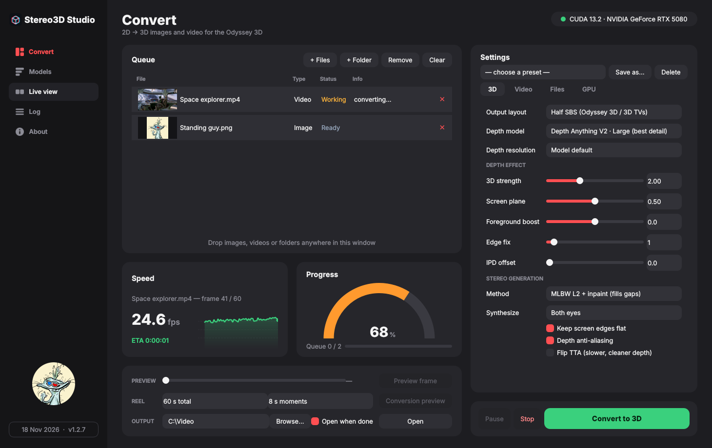
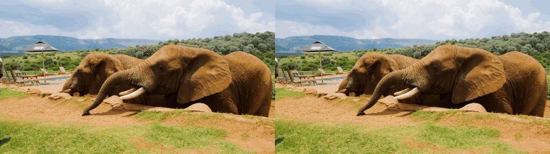

<p align="center">
  
</p>

<h1 align="center">Stereo3D Studio</h1>

<p align="center">
  <b>2D → 3D image &amp; video converter for Windows, with NVIDIA GPU acceleration.</b><br>
  Made for the Samsung Odyssey 3D, and works with 3D TVs, VR headsets and anaglyph glasses.
</p>

<p align="center">
  
</p>

Stereo3D Studio is a desktop app built on [iw3](https://github.com/nagadomi/nunif/tree/master/iw3), nagadomi's
2D-to-stereo engine. It estimates depth with modern AI depth models, builds a second eye for every frame, and encodes
the result as side-by-side (SBS) 3D video — with a queue, presets, live preview and a one-click Windows installer.

## Sample: 2D → 3D

<p align="center">
  <a href="https://github.com/drewmedina55-ux/Stereo3DStudio/raw/main/docs/sample/elephants_Any_V2_L_HSBS.mp4">
    
  </a>
</p>

A 4K stock clip converted to Half SBS 3D with Depth Anything V2 Large (Odyssey 3D preset, 1080p processing).
**[⬇ Download the 3D video](https://github.com/drewmedina55-ux/Stereo3DStudio/raw/main/docs/sample/elephants_Any_V2_L_HSBS.mp4)**
(MP4, HEVC, 1920×1080 Half SBS, 22 s, 34 MB) and play it fullscreen in a 3D player or on the Odyssey 3D — or
free-view the preview above (parallel).

Source footage: [Footage of Elephants Eating Together](https://www.pexels.com/video/footage-of-elephants-eating-together-3842822/) on Pexels.

## Features

- **Drag & drop queue** for videos, images and whole folders, with thumbnails; finished items leave the queue.
- **Odyssey 3D presets** — Half SBS output, Depth Anything V2 Large, MLBW + inpaint stereo, tuned for 16 GB GPUs.
- **Every 3D format**: Half / Full SBS, top-bottom, VR180, cross-eyed, anaglyph, RGB + depth — see [3D output modes](#3d-output-modes).
- **Many depth models**: Depth Anything V2 / V3, Video Depth Anything (least flicker), Distill Any Depth,
  Depth Pro, ZoeDepth — non-commercial models are downloaded from their official pages after you accept the license.
- **GPU everywhere**: CUDA depth + stereo, NVENC encoding, NVDEC decoding, FP16; recovers automatically
  from out-of-memory errors.
- **Live view** — a small window that shows a converted frame every N frames while encoding
  (parallel, cross-eyed or raw) so you can judge the 3D by free-viewing. Pin it to the main window or let it float.
- **Titles** — text that fades in, holds and fades out at the start or end of a video, with font, colour,
  placement, opacity and a depth slider that places it behind, on or in front of the screen.
- **Frame preview** with side-by-side, anaglyph, wiggle and single-eye views.
- **Settings travel with the file** — every output video stores the settings used; drop it back into the window to
  restore them. Output names include the depth model.
- **Processing size** — 4K videos are converted at 1080p by default (several times faster); pick 1440p, 4K or
  source size in the Video tab when you want the extra detail.
- Auto-crop letterbox bars, flicker reduction, scene-cut detection, flip TTA, depth anti-aliasing and more.

## 3D output modes

Pick the mode in **Settings → 3D → Output layout**. Every mode works for videos and images, and the mode is added to the
output file name so players can recognise it. Sizes below are for a 1920×1080 source.

| Mode | File name ends in | Frame size (from 1080p) | Use it for |
|---|---|---|---|
| Half SBS *(default)* | `_HSBS` | 1920×1080 | Samsung Odyssey 3D, 3D TVs, most 3D monitors |
| Full SBS | `_LRF_Full_SBS` | 3840×1080 | VR / 3D video players on PC and headsets |
| Full Top-Bottom | `_TBF_fulltb` | 1920×2160 | Players and headsets that prefer over/under |
| Half Top-Bottom | `_HTB` | 1920×1080 | 3D TVs and projectors with a top-bottom mode |
| VR180 | `_180x180_LR` | 5760×2880 (180° per eye) | VR headsets (DeoVR, Skybox, Quest and similar) |
| Cross-eyed | `_RLF_cross` | 3840×1080 | Free-viewing on any screen by crossing your eyes |
| Anaglyph | `_redcyan_dubois` | 1920×1080 | Red/cyan paper glasses on any normal screen |
| RGB + Depth | `_RGBD` | 3840×1080 | Apps and displays that build 3D from a depth map |
| Half RGB + Depth | `_HRGBD` | 1920×1080 | Same, squeezed to the source size |

**Half SBS (side-by-side).** Left eye on the left, right eye on the right, each squeezed to half width so the file
keeps the source size. The display stretches each half back to full width in 3D mode. This is the format for the
Odyssey 3D: play the file fullscreen (VLC works well) and turn on 3D side-by-side in Odyssey 3D Hub.

**Full SBS.** Both eyes at full resolution next to each other, so the frame is twice as wide. Sharpest result, but
a normal player shows it squashed — use a 3D/VR player that understands full side-by-side.

**Full Top-Bottom.** Left eye on top, right eye underneath, each at full resolution (twice as tall). For players
and headsets that use over/under 3D.

**Half Top-Bottom.** Left eye on top, right eye underneath, each squeezed to half height. For 3D TVs and projectors
with a top-bottom (TAB) mode.

**VR180.** Each eye is projected onto a 180° half-sphere (equirectangular) and placed side by side (each eye becomes a square
half-sphere with the picture in the middle), so it wraps around you in a headset. Watch it in a VR video player set to 180° SBS.

**Cross-eyed.** Full side-by-side with the eyes swapped (right eye on the left). No equipment: cross your eyes until
the two pictures merge into one 3D picture in the middle. Best viewed small.

**Anaglyph.** One picture that mixes both eyes in red and cyan (Dubois colour method, which keeps the most natural
colour). Watch it with red/cyan glasses on any screen.

**RGB + Depth / Half RGB + Depth.** Not a stereo pair: the original picture on the left and its depth map (grey,
near = bright) on the right. For apps, holographic displays and tools that create their own 3D views from a depth
map. Titles are not drawn in these modes, so the depth half stays clean.

## ⭐ Conversion preview reel

Judge your settings on a whole movie in about a minute instead of converting all of it.

Select a video and click **Conversion preview**. Stereo3D Studio picks random moments spread evenly from the start to
the end of the film (by default 8-second moments adding up to 60 seconds), joins them with their sound, and converts
that reel with your current settings. The result is a short 3D sizzle reel that shows how the depth holds up across
dialogue, action, dark scenes and wide shots. Tweak the settings and run another reel — each click picks new moments —
or press **Convert to 3D** when it looks right. Reel length and moment length are adjustable, and the reel is saved as
`<name>_conversion-preview_<model>_HSBS.mp4` next to your other outputs.

## Requirements

- Windows 10 or 11, 64-bit
- NVIDIA GPU with a current driver (RTX 20-series or newer recommended; RTX 50-series supported).
  Runs on CPU without one, but very slowly.
- About 7 GB of disk space (Python runtime, PyTorch with CUDA, models)
- Internet connection during installation

## Install

1. Download the latest `Stereo3DStudio_vX.Y.Z_Setup.zip` from **Releases** and extract it where the app should live
   (for example `C:\Apps\Stereo3DStudio`).
2. Double-click **`Install Stereo3D Studio.bat`**. It downloads a private Python 3.12, the PyTorch CUDA build that
   matches your driver, the 3D engine's packages and the default depth model. Nothing is installed system-wide.
3. Start **Stereo3D Studio** from the Desktop or Start-menu shortcut.

Upgrading: copy the `models` folder from your old install into the new folder before running its installer, so
nothing is downloaded again. Settings and presets are kept automatically.

## Quick start

1. Drop a video onto the window.
2. Pick **★ Odyssey 3D · Best** (or another preset).
3. Optional: **Conversion preview** to check a 60-second reel first.
4. Press **Convert to 3D**. Output goes to a `3D` folder next to the source, or to the folder you choose,
   named like `Movie_Any_V2_L_HSBS.mp4`.

Play Half SBS files with a player that shows the frame as-is (for example VLC) and switch the display to its
side-by-side 3D mode. See [`README.txt`](README.txt) for tips on speed, edge artifacts and letterboxed films.

## Running from source

The installer creates `runtime\` (a Python 3.12 virtual environment). After installing once:

```bat
"Stereo3D Studio (console).bat"
```

or directly:

```bat
set PYTHONPATH=%CD%\app;%CD%\engine
runtime\Scripts\python.exe -m stereo3dstudio
```

`Stereo3DStudio.exe` is a tiny launcher compiled on your PC by the installer from
[`installer/Launcher.cs`](installer/Launcher.cs) with the C# compiler that ships with Windows.

### Releases

Releases are built automatically. Raise `VERSION` in `app/stereo3dstudio/__init__.py`, add
`release-notes/v<version>.md`, and push to `main`: the **Build and release** workflow builds the full setup package
on a Windows runner (including the launcher EXE) and publishes it as release `v<version>`.

### Project layout

| Path | What it is |
|---|---|
| `app/stereo3dstudio/` | The application: UI (PySide6), engine bridge, model manager, conversion-preview reel, title overlay |
| `engine/` | Unmodified snapshot of [nunif](https://github.com/nagadomi/nunif) (iw3), see `engine/ENGINE_VERSION.txt` |
| `installer/` | PowerShell installer, model pre-download helper, launcher source |
| `assets/` | App icon, splash screen, logo |

## Very special thanks

A very special thanks to **[nagadomi](https://github.com/nagadomi)**, author of
[nunif / iw3](https://github.com/nagadomi/nunif). Stereo3D Studio is built on the iw3 engine — its depth pipeline,
stereo generation and video processing are nagadomi's outstanding work, shared openly under the MIT License.
None of this would exist without it. Thank you!

## Credits

- Created by **Drew Medina** — [drewmedina.com](https://drewmedina.com)
- Made with **Claude Opus 5.5**
- 3D engine: **iw3 / nunif** by [nagadomi](https://github.com/nagadomi/nunif) (MIT License)
- Depth models by their respective authors (Depth Anything, Video Depth Anything, Distill Any Depth, Depth Pro,
  ZoeDepth) — see [THIRD_PARTY_NOTICES.md](THIRD_PARTY_NOTICES.md)

## License

Stereo3D Studio's own code is released under the
[PolyForm Noncommercial License 1.0.0](LICENSE) — **free for noncommercial use, not for sale.**

- ✅ Use, copy, change and share it for personal use, hobby projects, study, research, or in charities,
  schools and public institutions.
- ❌ Selling it, charging for it, bundling it in a paid product or service, or any other commercial use.
  For a commercial license, contact Drew Medina at [drewmedina.com](https://drewmedina.com).

Because it restricts commercial use, Stereo3D Studio is *source-available* rather than "open source" in the
OSI sense.

The bundled engine keeps its own MIT license (`engine/LICENSE`) — that license applies to nunif itself, not to
Stereo3D Studio. The character artwork in `assets/logo.png` / `docs/logo.png` is © Drew Medina, all rights
reserved, and is not covered by either license.

Depth models are **not** included in this repository. Several of them (Depth Anything V2 Base/Large, Video Depth
Anything Base/Large and others) are licensed **CC BY-NC 4.0 — non-commercial use only**.
