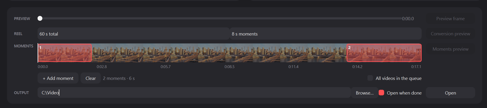

# Stereo3D Studio 1.1

Two big additions: **Apple Depth Pro 2**, Apple's newest depth model, and **Moments preview** for fair A/B testing.

## Download
**Stereo3DStudio_v1.1_Setup.zip** — extract it, run `Install Stereo3D Studio.bat`, then start Stereo3D Studio from the Desktop shortcut.
Upgrading: copy the `models` folder from your previous install into the new folder before installing.

## 🆕 Apple Depth Pro 2
Depth Pro 2 is Apple's newest depth model, and it's a great fit for 2D→3D video:
- **Sharp edges** — depth stays crisp at hair, fingers, leaves and thin objects, where conversions usually smear.
- **Stable, flicker-free video depth** — it's a multi-frame model: each frame also looks at the frames before it
  (up to 16), so depth doesn't flicker or "breathe". The memory resets at every new video and scene cut.
- **Four sizes:** Small (97 MB), Base (386 MB), **Large (1.3 GB, recommended)** and Huge+ (3.5 GB, sharpest, needs a lot
  of GPU memory).
- **Get it:** Models → select a Depth Pro 2 size → accept its license → Download. It downloads straight from Apple into
  your `models` folder; then pick it under Depth model. Depth resolution, edge fix and flip TTA all work with it.
- **License:** the weights are under the Apple Machine Learning Research Model License — research use only,
  non-commercial — and are not included in the download. "Apple Machine Learning Research Model is licensed under the
  Apple Machine Learning Research Model License Agreement."

## 🆕 Moments preview — A/B testing

The conversion preview reel picks random moments, so every run shows different scenes. **Moments preview** lets you pick
the scenes yourself, once, and reuse them for every test:
1. Select a video. The new **Moments** timeline under the reel shows a filmstrip of it.
2. **Double-click** to add a moment, **drag** to move it, drag its **edges** to resize, **right-click** to remove.
   The playhead follows the Preview slider.
3. Click **Moments preview** to convert only those moments, with their sound.
4. Change the model or any setting and run it again — same scenes, so you compare like for like.

Every run is kept (`<name>_moments-preview_<model>_HSBS.mp4`, then `_01`, `_02`…). Moments are remembered and shared
by every clip in the queue — tick **All videos in the queue** to convert the same moments of each video.

💡 Thanks to **[u/pagineinternet](https://www.reddit.com/user/pagineinternet/)** on Reddit for the idea!

## Also new
- The Models window shows each model's own license.
- The load screen no longer shows "Loading GPU engine…".

Created by Drew Medina — made with Claude Opus 5.5. Built on [nunif / iw3](https://github.com/nagadomi/nunif) by nagadomi.
Depth Pro 2 © Apple Inc.
